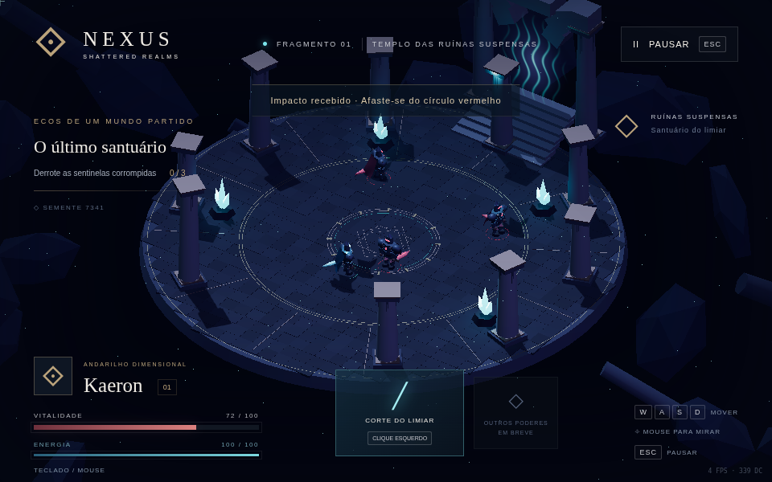

# NEXUS: Shattered Realms — 1.1

Um action RPG isométrico de fantasia sombria, construído com TypeScript, Three.js e geometria procedural. **Fase 1 com a atualização 1.1: Movement, Controller & Combat Polish.** Mantém a arena e o conteúdo da fundação, acrescenta entrada por controle e refina movimentação e golpe básico. Não inclui ataque pesado, esquiva, combos, habilidades, chefe ou progressão das fases seguintes.



## Executar no Fedora KDE (Konsole / Fish)

Requisitos: Node.js **22.12+ ou 24 LTS**, npm e um navegador com WebGL2 / aceleração gráfica. Nenhum comando exige Bash, Docker, serviços externos, chave de API ou assets remotos.

Na pasta do projeto:

```fish
npm install
npm run dev
```

Abra o endereço informado pelo Vite no navegador. Para uma instalação reproduzível, use `npm ci` no lugar de `npm install`. Se Node.js não estiver instalado no Fedora, instale-o pelo gerenciador de pacotes do sistema (`sudo dnf install nodejs npm`) e confira `node --version`.

```fish
npm test
npm run build
npm run preview
```

`build` verifica os tipos e gera `dist/`. Esse diretório pode ser servido por qualquer servidor estático; o jogo não tem backend. A distribuição desktop ainda não foi implementada. O projeto não foi executado diretamente no Fedora ou Windows nesta entrega.

## Como jogar

Clique em **Iniciar jornada**. Elimine as três sentinelas para purificar o santuário. O anel vermelho anuncia um ataque: afaste-se antes do impacto. O ataque de Kaeron interrompe a preparação do inimigo. A lâmina precisa realmente atravessar o corpo da sentinela durante a execução do corte. Seu alcance permite atacar antes que ela se aproxime. A energia se recompõe automaticamente.

| Comando            | Ação                                                |
| ------------------ | --------------------------------------------------- |
| W A S D            | Mover em relação à tela, com diagonais normalizadas |
| Mouse              | Orientar Kaeron no plano da arena                   |
| Clique esquerdo    | Corte do Limiar, ataque básico                      |
| J                  | Alternativa de teclado para atacar na direção atual |
| Esc / botão Pausar | Pausar e continuar                                  |

Ao perder toda a vida, use **Recomeçar no limiar**. As três sentinelas e seus recursos são restaurados. A pausa também acontece ao sair da aba ou perder o foco. Baixa, Média e Alta regulam resolução interna, sombras e bloom no menu principal. Não há suporte mobile/touch nesta fase.

**Combate:** 100 de vida, 14 de dano por ataque inimigo, 34 de dano por corte, custo de 18 de energia, regeneração de 15/s, duração de ataque 0,52 s, antecipação de 0,12 s, janela de execução entre 0,12 e 0,34 s e alcance máximo de 3,1 unidades. O acerto usa o volume planar varrido pela lâmina entre passos de simulação; cada inimigo recebe no máximo um acerto por golpe. As sentinelas anunciam ataques por 0,8 s e recuperam por 0,9 s. Não há dano por contato.

Esquiva, ataque pesado, combo, Q/E/R, chefe e progressão não fazem parte da Fase 1. Os slots futuros da interface não representam habilidades disponíveis.

## Mundo e arquitetura

- `src/main.ts`: integração do jogo, estados, combate, IA, câmera, interface, áudio sintético e pós-processamento.
- `src/input.ts`: teclado/mouse, Gamepad API padrão, seleção de dispositivo, deadzone e ações por borda de botão.
- `src/timing.ts`: simulação em passos fixos com recuperação limitada.
- `src/combat.ts` e `src/combat-effects.ts`: curvas do golpe, hitbox varrida e rastro ligado à lâmina.
- `src/visuals.ts`: personagem hierárquico articulado, capa deformável, espada extrudada e geração do templo.
- `src/mechanics.ts`: regras puras de colisão, arco de ataque, interpolação angular e PRNG determinístico.
- `src/style.css`: interface responsiva, menus e HUD.
- `tests/`: testes matemáticos e integração real em Chromium.

A arena usa a semente **7341**; experimente `?seed=1234` no endereço para gerar variações de alturas, pedras e distribuição de detalhes. A arquitetura da área navegável é deliberadamente fixa para manter rotas de combate livres. O piso usa `InstancedMesh`; as faíscas reutilizam um pool fixo de 200 partículas. Pedra, metal, visor, cristais, capa e espada são gerados em código. O portal usa GLSL com fluxo de energia animado. Não há modelos, imagens, fontes nem áudio baixados durante o jogo.

A simulação usa passos fixos de 1/60 s, preservando o tempo entre frames (até 0,5 s de recuperação por frame) em vez de descartar todo o delta acima de 50 ms. Pausa e perda de foco zeram o acumulador; não há recuperação de tempo passado em segundo plano. A velocidade tem aceleração/desaceleração suave e a passada acompanha o deslocamento real.

A física é planar: círculos com subpassos, deslizamento em obstáculos e limite circular da ilha. Não há saltos, quedas ou simulação volumétrica; Rapier não é necessário para este escopo. A IA tem patrulha, detecção/perseguição, preparação, ataque, recuperação, reação e morte. Após travamentos superiores a 0,5 s, a recuperação continua limitada para evitar grandes saltos. O renderizador por software ainda pode ter FPS baixo; esta atualização não comprova 60 FPS.

## Testes e evidências

Veja [o relatório da atualização 1.1](docs/1.1/TESTES.md), os resultados JSON em `docs/1.1/` e a sequência real do golpe em `docs/1.1/screenshots/`. O relatório anterior da Fase 1 foi preservado em `docs/TESTES.md`.

Para repetir os testes de navegador, mantenha `npm run dev` em outro terminal:

```fish
npm run test:browser
```

Por padrão o teste usa Chromium em `/usr/bin/chromium` com ANGLE SwiftShader (renderização por software). Se precisar, instale `chromium` no Fedora. Para outro executável:

```fish
set -x CHROMIUM_PATH /caminho/para/chromium
npm run test:browser
```

`NEXUS_URL` pode apontar para outro servidor, incluindo `?test=1`. Apenas esse parâmetro habilita a API de inspeção usada pelos testes. Ela observa o estado e posiciona o jogador para cenários isolados; ataques e danos ainda passam pelas entradas reais e pelo ciclo de jogo. Não existe no modo normal.

A meta de 60 FPS em 1080p **não foi comprovada**. O teste disponível usa software, não uma GPU intermediária. O relatório distingue esses resultados. O bundle contém o renderizador Three.js e gera um aviso de tamanho do Vite; isso não é falha de build.

Para medir uma amostra real em 1080p contra `npm run preview -- --port 5174`, execute `node tests/performance.mjs`. Ele registra 30 frames após aquecimento em `docs/performance.json`; o teste padrão usa software e não substitui medições com GPU real.

## Controle — Xbox / PlayStation

Conecte o controle por USB ou Bluetooth e pressione um botão para o navegador disponibilizá-lo. Use um navegador atualizado em contexto seguro (HTTPS ou localhost). Dispositivos reconhecidos como `mapping: standard` usam o mesmo esquema na Gamepad API: Xbox One/Series, DualShock 4 e DualSense podem funcionar por esse mapeamento. **Não houve teste com dispositivos físicos** nesta entrega. Dispositivos com mapeamento desconhecido são indicados e ignorados, mantendo o teclado disponível.

| Entrada                                         | Ação disponível                                  |
| ----------------------------------------------- | ------------------------------------------------ |
| Analógico esquerdo                              | Movimento proporcional à inclinação              |
| Analógico direito                               | Orientação independente                          |
| X / Quadrado                                    | Ataque básico; segurar não repete                |
| Menu / Options                                  | Pausar / continuar                               |
| A / X (nos menus)                               | Confirmar botão / avançar entre configurações    |
| D-pad cima/baixo ou analógico esquerdo vertical | Navegar; no campo de configuração, ajustar valor |
| B / Círculo (nos menus)                         | Voltar; retoma jogo quando pausado               |

Os botões de pesado, esquiva, especial, suprema e interação ficam reservados; não executam ações de fases futuras. A deadzone radial padrão é 18%, ajustável de 5% a 40% no menu e salva localmente quando o navegador permite. O seletor de controle permite escolher um dispositivo; no modo Automático, atividade em outro controle padrão o torna ativo. O indicador inferior informa a entrada usada. Teclado/mouse e controle podem ser alternados sem reiniciar. Solte o analógico após trocar para teclado; mova-o novamente para retomar o controle. Desconectar o controle ativo remove sua entrada, sem deixar o movimento preso.

O ataque tem buffer de 180 ms: um novo comando próximo ao final da recuperação inicia o próximo corte. Comandos antigos expiram. A direção fica travada durante o golpe; movimento continua em velocidade reduzida e volta suavemente à corrida após a recuperação. Um hitstop limitado a aproximadamente 50 ms reforça cada contato.

## Testar a atualização 1.1

Com `npm run dev` em outro terminal:

```fish
npm test
npm run test:movement
npm run test:controller
npm run test:combat
npm run test:browser
```

Os testes de movimento mantêm WASD por dois segundos de **tempo real**. O teste de controle injeta objetos padrão em `navigator.getGamepads()` e eventos de conexão/desconexão; ele não substitui hardware físico. O teste de combate controla `requestAnimationFrame` a 60 Hz para inspecionar as fases, mas usa renderização WebGL, entradas, animação, colisão e dano reais. Os demais testes de navegador usam o relógio normal. Para testar o build de produção, execute `npm run build`, `npm run preview -- --port 5174` e use `set -x NEXUS_URL 'http://127.0.0.1:5174/?test=1'` no terminal dos testes.

## Atualizar no Fedora / Fish

Na pasta do clone existente, confira `git status` e preserve suas alterações locais antes de trocar de branch:

```fish
git fetch origin feature/nexus-1.1-movement-combat
git switch -c feature/nexus-1.1-movement-combat FETCH_HEAD
npm ci
npm run dev
```

Se a branch já existir localmente, use `git switch feature/nexus-1.1-movement-combat` e `git pull --ff-only origin feature/nexus-1.1-movement-combat` antes de instalar. O uso de `FETCH_HEAD` também funciona com o clone original feito com `--single-branch`. A branch `main` permanece preservada.
