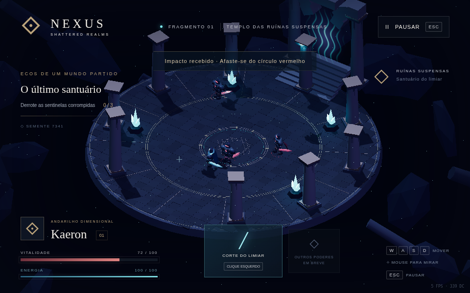

# NEXUS: Shattered Realms

Um action RPG isométrico de fantasia sombria, construído com TypeScript, Three.js e geometria procedural. **Esta entrega implementa a Fase 1: Fundação jogável.** Não inclui o combate avançado, chefe ou conteúdo das fases 2–4.



## Executar no Fedora KDE (Konsole / Fish)

Requisitos: Node.js **22.12+ ou 24 LTS**, npm e um navegador com WebGL2 / aceleração gráfica. Nenhum comando exige Bash, Docker, serviços externos, chave de API ou assets remotos.

Na pasta do projeto:

```fish
npm install
npm run dev
```

Abra o endereço informado pelo Vite no navegador. Para uma instalação reproduzível, use `npm ci` no lugar de `npm install`. Se Node.js não estiver instalado no Fedora, instale-o pelo gerenciador de pacotes do sistema (`sudo dnf install nodejs npm`) e confira `node --version`.

```fish
npm test
npm run build
npm run preview
```

`build` verifica os tipos e gera `dist/`. Esse diretório pode ser servido por qualquer servidor estático; o jogo não tem backend. A distribuição desktop ainda não foi implementada. O projeto não foi executado diretamente no Fedora ou Windows nesta entrega.

## Como jogar

Clique em **Iniciar jornada**. Elimine as três sentinelas para purificar o santuário. O anel vermelho anuncia um ataque: afaste-se antes do impacto. O ataque de Kaeron interrompe a preparação do inimigo. O alcance da espada permite atacar antes que ele se aproxime. A energia se recompõe automaticamente.

| Comando | Ação |
| --- | --- |
| W A S D | Mover em relação à tela, com diagonais normalizadas |
| Mouse | Orientar Kaeron no plano da arena |
| Clique esquerdo | Corte do Limiar, ataque básico |
| J | Alternativa de teclado para atacar na direção atual |
| Esc / botão Pausar | Pausar e continuar |

Ao perder toda a vida, use **Recomeçar no limiar**. As três sentinelas e seus recursos são restaurados. A pausa também acontece ao sair da aba ou perder o foco. Baixa, Média e Alta regulam resolução interna, sombras e bloom no menu principal. Não há suporte mobile/touch nesta fase.

**Combate:** 100 de vida, 14 de dano por ataque inimigo, 34 de dano por corte, custo de 18 de energia, regeneração de 15/s, duração de ataque 0,52 s, impacto em 0,20 s e alcance de 3,1 unidades. O acerto exige distância e arco frontal; cada inimigo recebe no máximo um acerto por golpe. As sentinelas anunciam ataques por 0,8 s e recuperam por 0,9 s. Não há dano por contato.

Esquiva, ataque pesado, combo, Q/E/R, controle, chefe e progressão não fazem parte da Fase 1. Os slots futuros da interface não representam habilidades disponíveis.

## Mundo e arquitetura

- `src/main.ts`: ciclo de jogo, entrada, estados, combate, IA, câmera, interface, áudio sintético e pós-processamento.
- `src/visuals.ts`: personagem hierárquico articulado, capa deformável, espada extrudada e geração do templo.
- `src/mechanics.ts`: regras puras de colisão, arco de ataque, interpolação angular e PRNG determinístico.
- `src/style.css`: interface responsiva, menus e HUD.
- `tests/`: testes matemáticos e integração real em Chromium.

A arena usa a semente **7341**; experimente `?seed=1234` no endereço para gerar variações de alturas, pedras e distribuição de detalhes. A arquitetura da área navegável é deliberadamente fixa para manter rotas de combate livres. O piso usa `InstancedMesh`; as faíscas reutilizam um pool fixo de 200 partículas. Pedra, metal, visor, cristais, capa e espada são gerados em código. O portal usa GLSL com fluxo de energia animado. Não há modelos, imagens, fontes nem áudio baixados durante o jogo.

A física é planar: círculos com subpassos, deslizamento em obstáculos e limite circular da ilha. Não há saltos, quedas ou simulação volumétrica; Rapier não é necessário para este escopo. A IA tem patrulha, detecção/perseguição, preparação, ataque, recuperação, reação e morte. O movimento/animação usa delta limitado a 50 ms para impedir saltos após travamentos; em máquinas muito lentas a simulação desacelera.

## Testes e evidências

Veja [o relatório](docs/TESTES.md), [os resultados brutos](docs/browser-results.json) e as [screenshots reais](docs/screenshots/).

Para repetir os testes de navegador, mantenha `npm run dev` em outro terminal:

```fish
npm run test:browser
```

Por padrão o teste usa Chromium em `/usr/bin/chromium` com ANGLE SwiftShader (renderização por software). Se precisar, instale `chromium` no Fedora. Para outro executável:

```fish
set -x CHROMIUM_PATH /caminho/para/chromium
npm run test:browser
```

`NEXUS_URL` pode apontar para outro servidor, incluindo `?test=1`. Apenas esse parâmetro habilita a API de inspeção usada pelos testes. Ela observa o estado e posiciona o jogador para cenários isolados; ataques e danos ainda passam pelas entradas reais e pelo ciclo de jogo. Não existe no modo normal.

A meta de 60 FPS em 1080p **não foi comprovada**. O teste disponível usa software, não uma GPU intermediária. O relatório distingue esses resultados. O bundle contém o renderizador Three.js e gera um aviso de tamanho do Vite; isso não é falha de build.

Para medir uma amostra real em 1080p contra `npm run preview -- --port 5174`, execute `node tests/performance.mjs`. Ele registra 30 frames após aquecimento em `docs/performance.json`; o teste padrão usa software e não substitui medições com GPU real.
